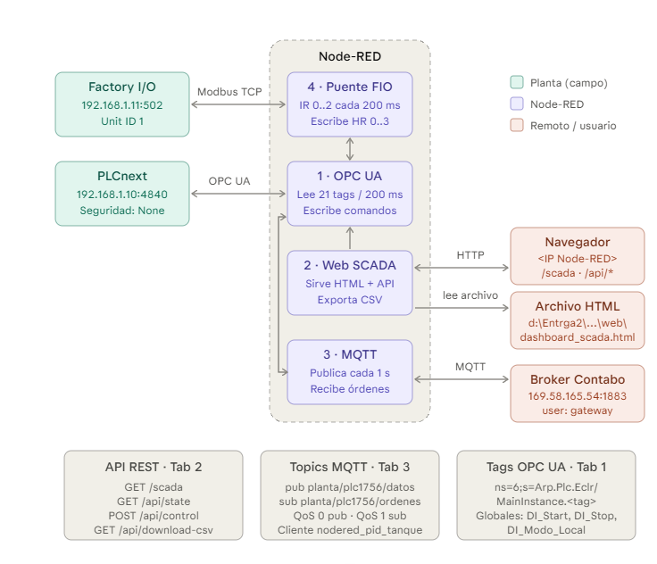
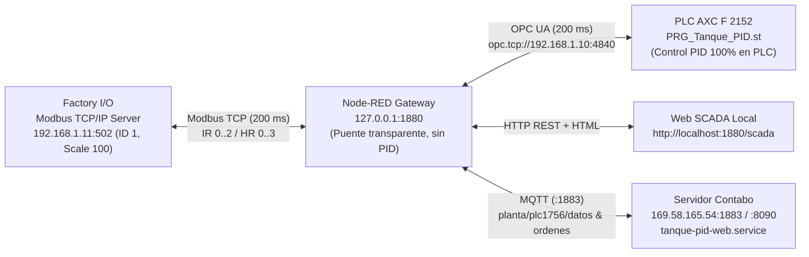

# Control PID de Nivel de Tanque — PLCnext AXC F 2152 + Factory I/O + Node-RED + MQTT

Sistema completo de automatización y supervisión industrial donde el **PLC Phoenix Contact `AXC F 2152`** ejecuta el **100 % del control PID** en Structured Text, **Factory I/O** simula la planta física del tanque, **Node-RED** actúa como puente transparente **Modbus TCP ↔ OPC UA** y gateway **MQTT**, y el **Web SCADA** permite supervisar y comandar el proceso tanto en red local como desde Internet (Contabo).

---

## 1. Arquitectura en Funcionamiento





### Flujo de señales
1. **Sensores (Factory I/O → PLC):** Node-RED lee `Input Registers 0..2` (`Level meter`, `Flow meter`, `Setpoint`) de Factory I/O y los escribe por OPC UA en `MainInstance.Level_Meter_Raw`, `MainInstance.Flow_Meter_Raw` y `MainInstance.Setpoint_Pot_Raw`.
2. **Cálculo PID (100 % en el PLC):** `PRG_Tanque_PID` calcula las salidas de control en el `AXC F 2152`.
3. **Actuadores (PLC → Factory I/O):** Node-RED lee por OPC UA `MainInstance.Fill_Valve_Raw`, `MainInstance.Discharge_Valve_Raw`, `MainInstance.SP_Display_CM` y `MainInstance.PV_Display_CM`, y los escribe en `Holding Registers 0..3` de Factory I/O.
4. **Supervisión y Mando Remoto:** Node-RED sirve el Web SCADA local (`/scada`), registra histórico CSV (`/api/download-csv`) y sincroniza telemetría/órdenes vía MQTT con Contabo (`http://169.58.165.54:8090`).

---

## 2. Inventario de Archivos del Proyecto

```text
d:\Entrga2\COMPLCconexMQTT-main\
├── App1.plcnx2                                     # Proyecto base de PLCnext Engineer
├── README.md                                       # Documentación principal (este archivo)
├── README_GUIA_NODE_RED_PLC.md                     # Guía técnica adicional
├── plcnext_st\
│   ├── PRG_Tanque_PID.st                           # Programa ST completo con PID de nivel de tanque
│   ├── plcnext_engineer_code\
│   │   └── PRG_Tanque_PID_code.st                  # Solo cuerpo de código ST para PLCnext Engineer
│   └── csv\
│       ├── PRG_Tanque_PID_variables.csv            # Tabla de 55 variables para importar en PLCnext 2024.6
│       ├── csvnuebo.csv                            # Mapeo corregido de E/S hardware (incl. AO_Bargraph_Raw)
│       ├── etiquetas_variables_medicion.csv        # Etiquetas de variables de medición
│       └── COMO SE ESTRUTURA.csv                   # Plantilla de estructura CSV de PLCnext
├── node-red\
│   └── flow_plcnext_scada.json                     # Flujo completo de Node-RED (4 pestañas)
├── web\
│   ├── dashboard_scada.html                        # Interfaz Web SCADA (gráficas, PID, START/STOP, CSV)
│   └── server_pid_contabo.py                       # Servidor HTTP + puente MQTT para Contabo (:8090)
├── docs\
│   └── TABLA_MAESTRA_TAGS.md                       # Tabla maestra de tags y permisos OPC UA
└── scripts\
    └── verificar_entorno.ps1                       # Diagnóstico de red, puertos y servicios
```

---

## 3. Flujo de Node-RED (`node-red/flow_plcnext_scada.json`)

Consta de **4 pestañas**:

1. **`1. PLCnext OPC UA (192.168.1.10)`** — Cada `200 ms` lee las variables globales (`DI_Start`, `DI_Stop`, `DI_Modo_Local`) y de `MainInstance.*` en `opc.tcp://192.168.1.10:4840`, actualiza el estado global `tanque_state` + registro CSV en memoria, y despacha comandos OPC UA hacia el PLC.
2. **`2. Web SCADA (dashboard_scada.html)`** — Expone `GET /scada`, `GET /api/state`, `POST /api/control` y `GET /api/download-csv`.
3. **`3. MQTT Telemetría (Contabo)`** — Publica telemetría cada 1 s en `planta/plc1756/datos` y escucha órdenes bidireccionales en `planta/plc1756/ordenes` (`169.58.165.54:1883`).
4. **`4. Puente Modbus <-> PLC`** — Puente transparente entre Factory I/O (`192.168.1.11:502`, `Slave ID 1`) y el PLC vía OPC UA (sin cálculos PID en Node-RED).

---

## 4. Configuración de Factory I/O (`Modbus TCP/IP Server`)

- **Driver:** `Modbus TCP/IP Server`
- **Host:** `192.168.1.11` | **Port:** `502` | **Slave ID:** `1` | **Scale:** `100`
- **I/O Config:** `Write Digital: Inputs`, `Read Digital: Coils`, `Write Register: Input Registers`, `Read Register: Holding Registers`

| Dirección Modbus | Tipo | Etiqueta en Factory I/O | Variable en PLC (`MainInstance.*`) |
| :--- | :--- | :--- | :--- |
| `Input Reg 0` | Sensor (FIO → PLC) | `Level meter` | `Level_Meter_Raw` (`INT`) |
| `Input Reg 1` | Sensor (FIO → PLC) | `Flow meter` | `Flow_Meter_Raw` (`INT`) |
| `Input Reg 2` | Sensor (FIO → PLC) | `Setpoint` | `Setpoint_Pot_Raw` (`INT`) |
| `Holding Reg 0` | Actuador (PLC → FIO) | `Fill valve` | `Fill_Valve_Raw` (`INT`) |
| `Holding Reg 1` | Actuador (PLC → FIO) | `Discharge valve` | `Discharge_Valve_Raw` (`INT`) |
| `Holding Reg 2` | Display (PLC → FIO) | `SP` | `SP_Display_CM` (`INT`) |
| `Holding Reg 3` | Display (PLC → FIO) | `PV` | `PV_Display_CM` (`INT`) |

---

## 5. Operación y URLs Activas

- **Node-RED Editor:** `http://127.0.0.1:1880`
- **Web SCADA Local:** `http://localhost:1880/scada`
- **Web SCADA Remoto (Contabo):** `http://169.58.165.54:8090` (servicio `tanque-pid-web.service`)
- **Scripts de arranque/verificación en el equipo:** `D:\PLCnext_Operacion\iniciar_todo.ps1` y `D:\PLCnext_Operacion\verificar_todo.ps1`
